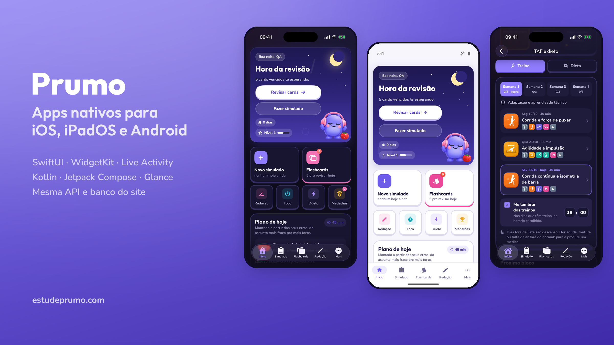
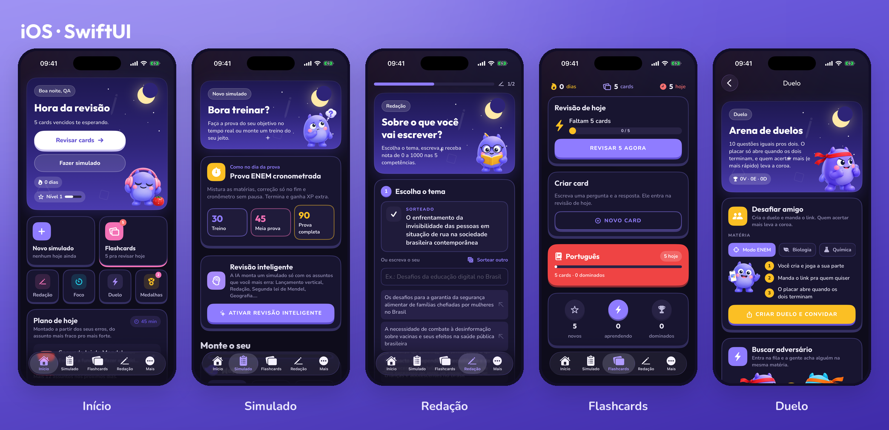
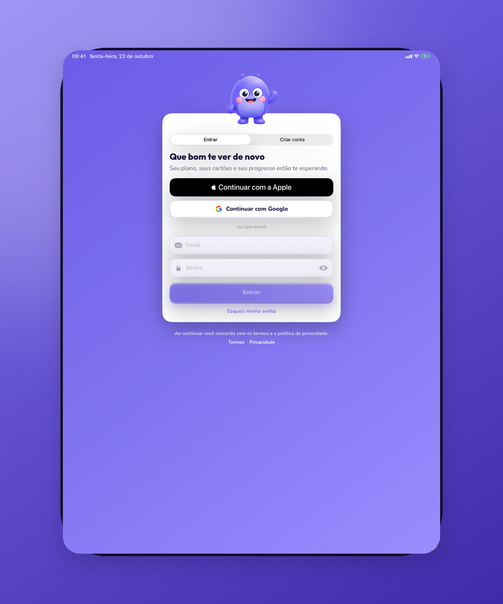
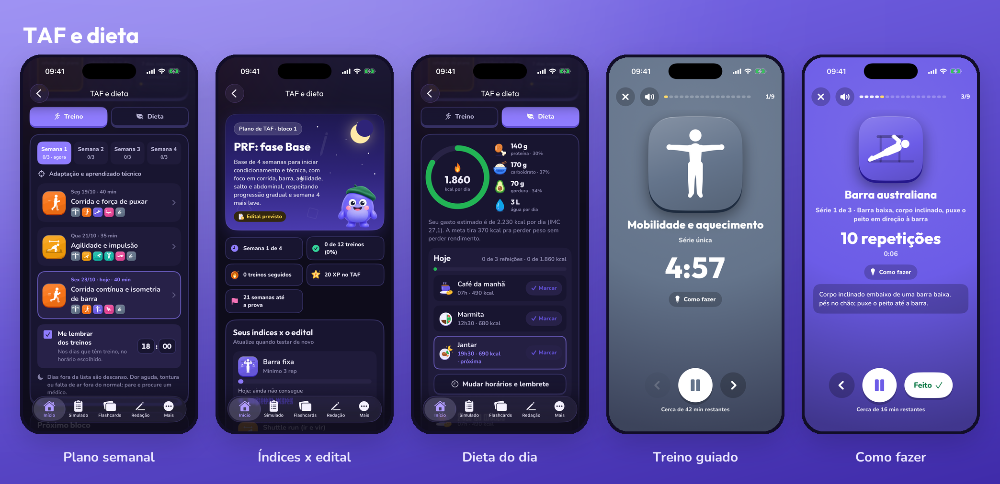

# Prumo para iOS e Android: o visual

Apps nativos da Prumo, plataforma de estudos com IA para ENEM e concursos.

Este repositório é um estudo de caso do visual dos apps. O código-fonte é proprietário e não
está aqui. Eu fiz o visual e o [Victor](https://github.com/burnoutscript) fez a parte de
trás: código nativo, assinatura e integração com o servidor. O estudo de caso dele está em
[burnoutscript/prumo-apps](https://github.com/burnoutscript/prumo-apps).

## O desafio

A Prumo nasceu na web, com visual de desenho animado. No app, o aluno precisava reconhecer a
Prumo na hora, mas a tela tinha que parecer de iPhone no iPhone e de Android no Android. Copiar
o site pixel por pixel deixaria o app estranho; seguir só o padrão do sistema deixaria o app
sem cara.

| | |
|---|---|
| Status | Em testes internos. Publicação na App Store e na Google Play em breve |
| Plataformas | iPhone e iPad (iOS 17+), Android 8+ |
| Meu papel | Visual das telas, widgets e telas de treino |
| Time | Eu no visual, o Victor no código nativo e no backend |

## iOS

As mesmas cores, a mesma borda grossa e o mesmo mascote do site, com a navegação e os gestos
que quem usa iPhone já conhece.

## Widgets

O widget é o que o aluno vê toda vez que desbloqueia o celular. Por isso ele mostra uma coisa
só, grande: a meta da semana, a sequência de dias ou o treino do dia.

## Android

As mesmas telas do iOS, adaptadas ao jeito do Android.

## Treino do TAF

Quem presta concurso policial precisa passar no teste físico. As telas de treino e dieta usam
o mesmo visual do resto da Prumo, para o aluno sentir que está no mesmo lugar onde estuda.

## Decisões de visual

#### Um visual, três telas

Site, iPhone e Android usam as mesmas cores, as mesmas fontes e o mesmo mascote. Muda só o que
o sistema pede: a barra de navegação, os gestos e o jeito de voltar.

#### Tema claro e escuro desde o começo

Toda tela foi desenhada nos dois temas. Ninguém estuda à noite com uma tela branca na cara.

#### Uma coisa principal por tela

Cada tela tem uma ação principal bem destacada. Na tela pequena do celular, o aluno não pode
ter dúvida de onde tocar.

## Contato

Marcos Alan, cofundador e CTO da Prumo · [GitHub](https://github.com/nullfeel) ·
[estudeprumo.com](https://estudeprumo.com)

Código-fonte proprietário. Este repositório contém apenas documentação pública do projeto.
